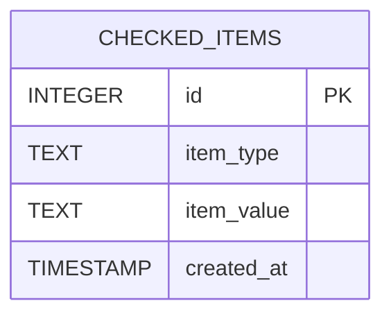

# DATABASE ER DIAGRAM
## Bloom Filter for Username and URL Checking

### Entity: checked_items

| Attribute | Data Type | Description |
|---|---|---|
| id | INTEGER | Primary Key |
| item_type | TEXT | Username or URL |
| item_value | TEXT | Actual username or URL |
| created_at | TIMESTAMP | Record creation date and time |

### ER Diagram

### Explanation

The database contains one entity named `checked_items`.

- `id` uniquely identifies each record.
- `item_type` identifies whether the record is a username or URL.
- `item_value` stores the actual username or URL.
- `created_at` stores the record creation timestamp.

The `id` attribute is the primary key.

A UNIQUE constraint on `(item_type, item_value)` prevents duplicate usernames or URLs of the same type.

There are no relationships with other tables because this project uses a single-table database design.
